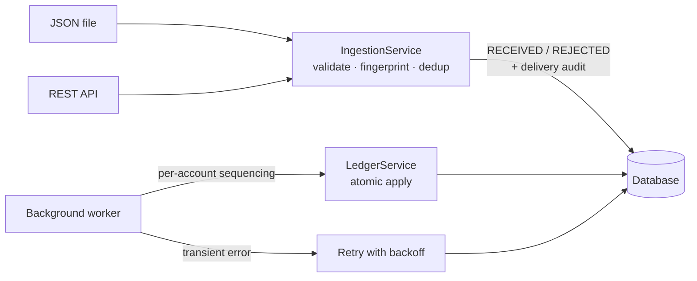

# Idempotent Background Transaction Processing Service

A background service that applies transaction requests **exactly once in effect** and **in the correct order per account**. It is built for input that is duplicated, out of order, or retried after partial failures, and keeps every outcome traceable. The project is a submission for the Practical FDE Assessment (FDE L2).

**Stack:** Java 17 · Spring Boot 3.4 · Spring Data JPA · H2 (embedded) · JUnit 5 · Micrometer

| Document | What's in it |
|---|---|
| **README** (this page) | Quick start, how it works, decisions, assumptions, tests |
| [docs/HLD.md](docs/HLD.md) | High-level design: architecture, lifecycle, strategy, trade-offs, NFR/FR traceability |
| [docs/LLD.md](docs/LLD.md) | Low-level design: packages, schema, algorithms, sequence diagrams, API, config, test matrix |
| [samples/output.txt](samples/output.txt) | Captured output of a real run on the brief's test data |

---

## Quick start

**Prerequisite:** JDK 17 or newer. Maven is not needed; the wrapper downloads it. On Windows, use `mvnw.cmd` instead of `./mvnw`.

```bash
./mvnw clean verify          # build and run all 46 tests
```

### 1. Batch mode: process a file, print the report, exit

```bash
java -jar target/txn-service.jar --spring.profiles.active=batch --input=samples/input.json
```

`samples/input.json` is the brief's §9.8 test data. A second file, `samples/input-edge-cases.json`, covers a payload conflict, an overdraft, a reversal, a double reversal, a sequence gap and malformed records.

State is kept in `./data/` (H2 file). **Run the same command again** to see idempotency across restarts: every delivery becomes `DUPLICATE` and the balances do not change. Delete `./data/` to start fresh.

### 2. Server mode: REST intake and a background worker

```bash
./mvnw spring-boot:run
```

```bash
# Submit a transaction (202 ACCEPTED). Repeat the call: 200 DUPLICATE.
curl -i -H "Content-Type: application/json" -d '{"transactionId":"TXN-1","requestId":"REQ-1","accountId":"ACC-1","transactionType":"CREDIT","amount":100,"currency":"USD","sequenceNumber":1}' localhost:8080/transactions

# Submit a batch (JSON array): one result per item (207)
curl -H "Content-Type: application/json" -d @samples/input.json localhost:8080/transactions

curl localhost:8080/transactions/TXN-1       # state + every delivery of this transaction
curl localhost:8080/accounts/ACC-1           # balance + ledger
curl localhost:8080/report                   # processing summary
curl localhost:8080/actuator/metrics/txn.deliveries
curl -X POST localhost:8080/admin/transactions/TXN-1/replay   # re-queue a FAILED transaction
```

In server mode the worker polls every 500 ms. A brand-new account's events are held for a 5-second reorder window before processing, so a `GET` immediately after a `POST` may still show `RECEIVED` or `PENDING`.

### Sample output (brief §9.8 data)

```
#    requestId    transaction  outcome    reason
1    REQ-2        TXN-2002     ACCEPTED
2    REQ-1        TXN-2001     ACCEPTED
3    REQ-2-DUP    TXN-2002     DUPLICATE  Already received with an identical payload
4    REQ-3        TXN-2003     ACCEPTED
5    REQ-4        TXN-2004     REJECTED   amount must be greater than zero
6    REQ-5        TXN-2005     ACCEPTED
WARN event=txn.retry_scheduled transactionId=TXN-2005 attempt=1 ... reason="Simulated transient downstream failure"

txn        account  type       seq     amount status         att  detail
TXN-2001   ACC-201  CREDIT       1    100 USD PROCESSED        1
TXN-2002   ACC-201  DEBIT        2     40 USD PROCESSED        1
TXN-2003   ACC-201  CREDIT       3     25 USD PROCESSED        1
TXN-2004   ACC-202  -            4          - REJECTED         0  amount must be greater than zero
TXN-2005   ACC-203  CREDIT       5    500 USD PROCESSED        2

Deliveries received : 6  {ACCEPTED=4, DUPLICATE=1, REJECTED=1}
Transactions        : 5  {PROCESSED=4, REJECTED=1}
Retried             : 1 transaction(s), 1 retry attempt(s)
Ledger entries      : 4
Balances            : ACC-201=85 USD  ACC-203=500 USD
```

The DEBIT (seq 2) arrived first but was applied after the CREDIT (seq 1). The duplicate had no effect. The invalid record was isolated. The transient failure was retried once with no duplicate ledger entry.

---

## How it works



1. **Intake is idempotent and never applies money.** Each delivery is validated and fingerprinted (SHA-256 of the business fields), then:
   - stored as `RECEIVED` if the `transactionId` is new;
   - classified as **DUPLICATE** if the id exists with the same payload;
   - classified as **CONFLICT** if the id exists with a different payload.

   Every delivery is written to an audit log.
2. **The worker applies transactions in sequence per account.** Only `lastAppliedSeq + 1` is applied; later sequences wait as `PENDING`.
3. **Each apply is one database transaction:** ledger entry, balance, cursor and `PROCESSED` status commit together or not at all.
4. **Failures are classified.**
   - Business failures (insufficient funds, currency mismatch, invalid reversal) go straight to `FAILED`.
   - Transient failures are retried with exponential backoff, up to 3 attempts, then `FAILED`.
   - An operator can replay a `FAILED` transaction.

**Transaction lifecycle:**
`RECEIVED → (PENDING) → PROCESSING → PROCESSED`. Side branches: `PROCESSING → RETRY_PENDING → PROCESSING`, and `→ FAILED`. Input that fails validation is `REJECTED`.

**Delivery outcomes:** `ACCEPTED` · `DUPLICATE` · `CONFLICT` · `REJECTED`

---

## Key design decisions and trade-offs

| Decision | Why | Trade-off |
|---|---|---|
| **Idempotency key = `transactionId`** (database primary key), not `requestId` | Retrying clients often send a new request id. The brief's `REQ-2-DUP` must be a duplicate. | Clients must keep transaction ids stable |
| **Payload fingerprint** separates duplicate from conflict | Reusing an id with a different amount is a bug or tampering; it must never be applied silently | A slightly heavier intake path (one hash) |
| **Ordering Option A: sequence numbers per account** | Prevents false overdrafts (the debit-before-credit case in the brief). Accounts stay independent and parallel, which maps to partitioning by account key. | Head-of-line blocking within one account while a gap or retry is pending |
| **Reorder window for new accounts** (whole batch, or 5s when streaming) | A new account has no cursor. Starting from the first arrival would apply the brief's seq-2 DEBIT first. | Adds latency to a new account's first events. In production the starting sequence would come from onboarding. |
| **Failed or invalid records use up their sequence slot** | One bad record must not block an account forever (brief: invalid records must not stop the batch) | Later transactions continue past a failure; the failure is reported and replayable |
| **Gaps are reported and alerted, never auto-skipped** | Auto-skipping could reorder money movements | A missing event needs an operator decision |
| **Atomic apply, fault injected after the writes** | Proves that a crash at the worst moment leaves no partial state and that a retry produces exactly one effect | — |
| **Database as the durable inbox** (no separate queue) | Survives restarts; the same shape as a database-backed job processor; easy to run locally | Polling; at scale a broker would replace it (see production hardening below) |
| **H2 embedded** | Brief allows lightweight persistence; real constraints and transactions | Not for production; swap to PostgreSQL through `DB_URL` |

## Assumptions

1. Delivery is at-least-once, so duplicates and replays are normal conditions, not errors.
2. `transactionId` is globally unique. A new `requestId` with the same `transactionId` is a duplicate.
3. Same `transactionId` with a different payload is a `CONFLICT`. It is not applied, and the original is kept.
4. `sequenceNumber` is per account and contiguous. A new account starts at the lowest sequence seen in its reorder window.
5. Overdraft is not allowed. A DEBIT that exceeds the balance becomes `FAILED` and is not retried.
6. Each account has one currency, set by its first applied transaction. No currency conversion.
7. A `REVERSAL` references `originalTransactionId` on the same account, reverses the full amount, and can be applied once.
8. Transient failures are simulated by configuration (`processing.fault.transient-failures`; TXN-2005 fails once).

[HLD §11](docs/HLD.md#11-ambiguities-in-the-brief-and-decisions-taken) lists each ambiguity in the brief and the reasoning behind the decision taken.

## Tests

`./mvnw test` runs **46 tests**. Integration tests use an isolated in-memory H2 database.

| Area | Highlights |
|---|---|
| Brief scenario | The §9.8 dataset end to end: each row's outcome, attempts, balances, ledger count |
| Idempotency | New requestId → duplicate · payload change → conflict · late duplicate · whole-batch replay · **10 concurrent deliveries → 1 effect** |
| Ordering | **25 seeded random shuffles → identical final state** · gap → `PENDING` → released · reorder window · rejected-slot handling |
| Resilience | Failure after side effect → rollback → exactly one effect · retry exhaustion · head-of-line wait · overdraft not retried · operator replay · crash recovery |
| Domain and API | Every validation rule · reversals · REST status codes · safe error for malformed JSON |

The full matrix, mapped to the brief's requirements, is in [LLD §9](docs/LLD.md#9-test-matrix).

## Observability and data handling

- **Logs:** one `key=value` event per state change (`event=txn.processed`, `delivery.duplicate`, `txn.retry_scheduled`, `txn.failed`, `sequence.gap.alert`, …), with MDC context. Account ids are masked (`ACC***1`) and amounts are never logged. For JSON logs, set `logging.structured.format.console=logstash`.
- **Metrics:** `txn.deliveries{outcome}`, `txn.processing{result}` and `txn.sequence.gap.alerts`, at `/actuator/metrics`.
- **Report:** `GET /report` or the batch summary. It shows counts by status and outcome, retries, duplicates, conflicts, rejections, failures with reasons, missing sequence numbers and balances.
- **Security:**
  - all input is validated before processing, and error messages never echo raw input;
  - the API never returns stack traces;
  - no secrets in code (`DB_URL`, `DB_USER`, `DB_PASSWORD` come from the environment).

## Project structure

```
src/main/java/com/fde/txn/
  domain/       pure business rules: validation, fingerprint, status model (no framework)
  ingestion/    input adapters (file, REST) + idempotent IngestionService
  processing/   TransactionProcessor (sequencing, retry), LedgerService (atomic apply), worker, recovery
  persistence/  JPA entities + repositories
  reporting/    report, views, metrics, log masking
  app/          wiring + batch CLI runner
samples/        input.json (brief data), input-edge-cases.json, output.txt
docs/           HLD.md, LLD.md
```

## AI-assisted development

I used an AI coding assistant (Claude Code) throughout, as I would on the job: to analyse the brief, draft the design, generate code and tests, and write documentation. Every generated piece was reviewed, run and tested before it was accepted.

**How AI improved speed**

- It turned the brief into a requirement checklist and a draft HLD in minutes.
- It scaffolded entities, repositories and boilerplate, which left time to think about the hard parts: ordering, atomicity and failure classification.
- It produced a broad test matrix quickly, including the shuffle and concurrency tests.

**What validation caught, and what was corrected**

| Issue | How it was caught | Fix |
|---|---|---|
| A naive "start a new account at its first-seen sequence" rule would have applied the brief's DEBIT (seq 2) before its CREDIT (seq 1) | Design review against the test data | Added the reorder window |
| Deduplicating on `requestId` would have processed `REQ-2-DUP` twice | Design review against the test data | Dedup on `transactionId` plus a payload fingerprint |
| A REJECTED record with the same sequence as a valid one "stole" its slot, so the valid record was wrongly failed | Failing REST test | Valid records take precedence; added a regression test |
| H2 rounds timestamps to microseconds, so a just-scheduled retry could look "not yet due" | Failing crash-recovery test | Millisecond-tick clock |
| Amounts serialised as `1E+2` in JSON | Manual curl smoke test | Normalised decimal output |

**Validation approach**

- 46 automated tests, including property-style shuffles and a concurrency test.
- Real batch runs on the brief's data, with the output checked by hand.
- A curl smoke test of server mode.
- A manual read-through of every transaction boundary.

## Production hardening (next steps)

1. **Broker ingestion:** Kafka (key = `accountId`) or SQS FIFO (group = `accountId`) as one more `TransactionSource` adapter, with at-least-once delivery and the idempotent consumer kept as is. Scale out with one consumer per partition.
2. **PostgreSQL** with Flyway migrations. Use `INSERT … ON CONFLICT` for intake and `SELECT … FOR UPDATE SKIP LOCKED` for multi-worker claiming.
3. **Transactional outbox** for downstream side effects (notifications, the general ledger), published in the same transaction as the ledger entry.
4. **Dead-letter handling and tooling:** a DLQ view of `FAILED` and `CONFLICT` records, bulk replay, and an approved "skip sequence" action for gaps that will never fill.
5. **Starting sequence from account onboarding** instead of inferring it with the reorder window.
6. **Observability:** OpenTelemetry tracing across intake and apply; dashboards and alerts on failure rate, retry rate, gap age and processing lag; SLOs.
7. **Security:** authentication on the API (OAuth2 / mTLS), RBAC on admin endpoints, secrets from a vault, encryption at rest, PII classification.
8. **Data lifecycle:** retention and archiving for the delivery log, pagination on list endpoints, and rate limiting on intake.
