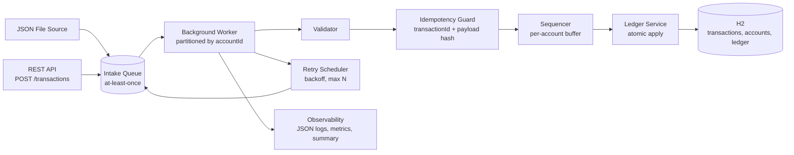
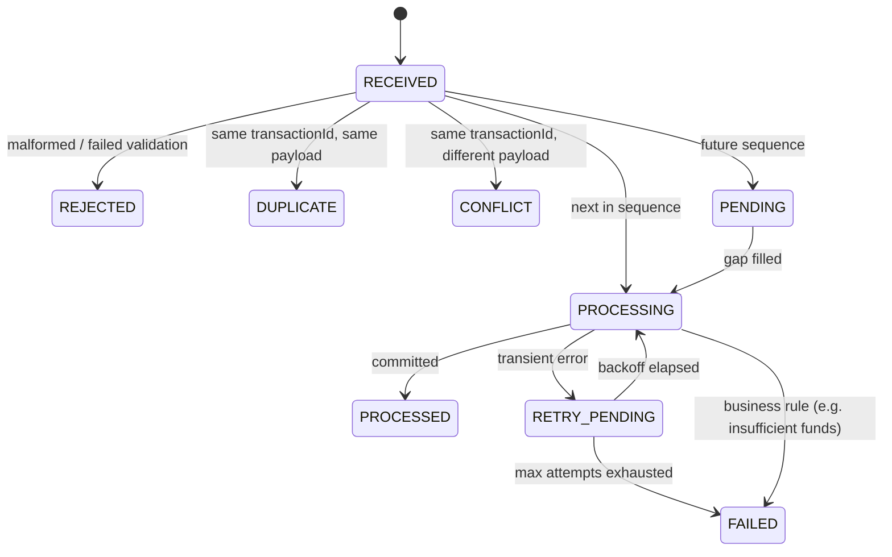

# High-Level Design — Idempotent Background Transaction Processing Service

**Assessment:** Practical FDE Assessment (FDE L2)
**Document status:** Phase 1 — High-Level Design, assumptions and open questions for review
**Next:** Phase 2 — Low-Level Design and implementation (on confirmation of the open questions)

---

## 1. Problem understanding

Upstream systems (APIs, files, schedulers, queues, retrying clients) deliver transaction requests **at least once** and **in any order**. Requests may be duplicated, replayed after partial failures, or arrive before the events they depend on.

The service must:

- apply each business transaction **exactly once in effect**, whatever the number of deliveries;
- apply transactions for an account in the **correct order**;
- survive transient failures and retry them **without double-applying** anything;
- never leave **partially updated** state;
- make every outcome (processed, duplicate, failed, retried, pending) **traceable and recoverable**.

The input mechanism is not the core challenge. The core challenge is safe processing under duplicate, out-of-order and retry conditions.

## 2. Scope

**In scope**

- Pluggable ingestion: JSON file (batch) and REST endpoint, behind a common source interface
- Input validation with bad-record isolation
- Background worker
- Idempotency store
- Per-account ordering
- Retry with a maximum attempt count
- Terminal failure handling
- Processing summary report and structured logs
- Unit and scenario tests

**Out of scope**

- Real broker integration (an adapter seam only)
- Distributed transactions
- Multi-region deployment
- UI
- Full authentication and authorisation
- A full observability stack

**Planned stack:** Java 21, Spring Boot 3, Spring Data JPA, H2 (embedded, file mode), JUnit 5, Micrometer, Logback JSON.

## 3. Context and architecture

The design has four layers:

| Layer | Contents |
|---|---|
| **Ingestion** | Adapters: file, REST, and later Kafka/SQS |
| **Application** | Worker orchestration and retry scheduling |
| **Domain** | Pure business rules: validation, state machine, balance rules. No framework dependencies. |
| **Infrastructure** | Persistence, logging, metrics |

Because the domain layer has no framework dependencies, a real queue or database can replace the in-process intake queue and H2 without touching business logic.

## 4. Component responsibilities

| Component | Responsibility |
|---|---|
| **TransactionSource** | Abstracts the input. File and REST implementations; seam for a future Kafka/SQS adapter. |
| **Validator** | Checks mandatory fields, amount > 0, ISO-4217 currency, known transaction type. Bad records are isolated and never stop the batch. |
| **Idempotency Guard** | Looks up `transactionId`. Same payload hash → `DUPLICATE`. Different payload → `CONFLICT`. |
| **Sequencer** | Tracks each account's expected sequence. Holds future events as `PENDING`, releases contiguous runs, reports gaps. |
| **Ledger Service** | Applies one transaction as a single atomic unit: ledger entry, balance update, status = `PROCESSED`. |
| **Retry Scheduler** | Moves transient errors to `RETRY_PENDING` with exponential backoff, and to `FAILED` after the maximum number of attempts. |
| **Reporter** | Counts by status, retries, gaps and final balances. Structured logs with masking of sensitive data. |

## 5. Transaction model

| Field | Notes |
|---|---|
| `transactionId` | Business identifier; **idempotency key** |
| `requestId` | Delivery/request identifier; used for tracing and retry correlation |
| `accountId` | Account reference; also the ordering and partition key |
| `transactionType` | `CREDIT`, `DEBIT`, `REVERSAL` |
| `amount` | Decimal (`BigDecimal`), never floating point |
| `currency` | ISO-4217 code |
| `sequenceNumber` | Per-account ordering |
| `eventTime` | Informational; used for audit and gap timeouts |
| `originalTransactionId` | Required for `REVERSAL` only |

**System-managed fields:** `status`, `attempts`, `payloadHash`, `lastError`, `receivedAt`, `processedAt`.

## 6. Status lifecycle

**Terminal states:** `PROCESSED`, `DUPLICATE`, `CONFLICT`, `REJECTED`, `FAILED`.

`FAILED` records keep their error and attempt history and can be replayed.

## 7. Key design decisions

### 7.1 Idempotency and duplicate detection

- The business key is **`transactionId`**. `requestId` is recorded for tracing and retry correlation only.
- A payload hash (SHA-256 of the business fields) separates a true duplicate (same hash → `DUPLICATE`) from a conflicting reuse of the same id (different hash → `CONFLICT`, flagged and never applied).
- Idempotency is enforced at two levels:
  1. a lookup in the Idempotency Guard;
  2. a database `UNIQUE(transaction_id)` constraint on the ledger, as the final safety net under concurrent delivery.

### 7.2 Out-of-order handling — Option A, sequence-based, per account

- Each account tracks `lastAppliedSeq`. The event with `lastAppliedSeq + 1` is applied.
- Events with a higher sequence wait as `PENDING`.
- Events with a lower sequence that has already been applied are `DUPLICATE`.
- **Reorder window for new accounts.** A brand-new account has no history, so the service collects its events for a short reorder window: until the end of the batch, or a configurable time in streaming mode. It then takes the lowest sequence seen as the account's starting sequence.
  - **Why it's needed:** in the sample data, ACC-201's DEBIT (seq 2) arrives before its CREDIT (seq 1). If the first event received simply became the starting point, the debit would be applied first.
- Gaps still open at the end of a batch are reported (for example, "ACC-x missing seq N"). In streaming mode they expire to `FAILED` with an alert after a configurable timeout.

**Trade-off.** Ordering per account keeps accounts independent and parallel. It fits partitioning by account key in Kafka or SQS FIFO, and it guarantees no false overdrafts. The cost is head-of-line blocking within a single account when a sequence is missing. A global sequence was rejected because it would serialise all accounts. Options B and C were also considered:

- **Option B (state-based):** a weaker fit, because balance correctness depends on order across different transactions, not on transitions within one transaction.
- **Option C (latest-state):** unsafe for a ledger, where every event matters and none can be "superseded".

### 7.3 Data consistency

- Applying one transaction is a single database transaction: ledger insert, balance update and status = `PROCESSED`.
- Any failure before commit rolls everything back, so a retry starts from a clean state. Partial updates are not possible.
- Optimistic locking (a version column) on the account protects against concurrent writers.

### 7.4 Resilience and retry

- Failures are classified as **transient** (for example, a downstream timeout, simulated with a configurable fault injector) or **permanent** (validation errors, insufficient funds).
- Transient failures are retried with exponential backoff, up to a maximum of **3 attempts**. After that the record becomes `FAILED`.
- Permanent failures are not retried.
- Retries reuse the same `transactionId`, so idempotency holds across attempts.
- Failed records keep `lastError` and `attempts`, and can be replayed through an admin endpoint.

### 7.5 Observability

- Structured JSON logs with MDC context: `transactionId`, `requestId`, `status`, `attempt`.
- One log event per state transition.
- Micrometer counters per status and retry, exposed through Spring Boot Actuator.
- An end-of-run processing summary: counts by status, retries, open gaps, final balances.

### 7.6 Security and data handling

- All input is validated before processing.
- `accountId` is masked in logs (for example, `ACC-***1`), and amounts are not logged at INFO level.
- No secrets in code; configuration is externalised (environment variables or profiles).
- Error responses never expose stack traces or internal details.

## 8. Requirements traceability

### 8.1 Non-functional requirements

| NFR | How it is addressed |
|---|---|
| 6.1 Idempotency | `transactionId` key, payload hash, database unique constraint (§7.1) |
| 6.2 Ordering | Per-account sequencer, `PENDING` buffer, reorder window, gap report (§7.2) |
| 6.3 Resilience | Classified retries, backoff, max attempts, replay of failed records (§7.4) |
| 6.4 Consistency | One atomic database transaction per applied event; optimistic locking (§7.3) |
| 6.5 Observability | Structured logs, metrics, processing summary (§7.5) |
| 6.6 Security | Validation, log masking, externalised configuration, safe errors (§7.6) |
| 6.7 Maintainability | Layered packages, framework-free domain, tests per scenario (§3) |

### 8.2 Functional requirements

| FR | Where it is addressed |
|---|---|
| L2-FR-01 Replaceable input source | TransactionSource (§4) |
| L2-FR-02 Validation | Validator (§4) |
| L2-FR-03 Processing state | Transaction model (§5), status lifecycle (§6) |
| L2-FR-04 Status lifecycle | §6 |
| L2-FR-05 Process each transaction only once | §7.1 |
| L2-FR-06 Detect late duplicates | §7.1 |
| L2-FR-07 Out-of-order strategy | §7.2 |
| L2-FR-08 Simulated retryable failure | Fault injector (§7.4) |
| L2-FR-09 Retry without duplicate effects | §7.3, §7.4 |
| L2-FR-10 Business logic separate from input handling | Layered architecture (§3) |
| L2-FR-11 Processing summary | §7.5 |
| L2-FR-12 Tests | §13, Phase 2 test matrix |

## 9. Sample data walkthrough (brief §9.8), under these assumptions

| Arrival | Transaction | Expected outcome |
|---|---|---|
| 1 | TXN-2002 · ACC-201 · DEBIT 40 · seq 2 | `PENDING`, then `PROCESSED` once seq 1 is applied |
| 2 | TXN-2001 · ACC-201 · CREDIT 100 · seq 1 | `PROCESSED` |
| 3 | TXN-2002 · REQ-2-DUP | `DUPLICATE` (same `transactionId`, same payload) |
| 4 | TXN-2003 · ACC-201 · CREDIT 25 · seq 3 | `PROCESSED` |
| 5 | TXN-2004 · ACC-202 · DEBIT −10 | `REJECTED`: failed validation (amount must be > 0) |
| 6 | TXN-2005 · ACC-203 · CREDIT 500 | `RETRY_PENDING` (simulated transient failure), then `PROCESSED` on retry |

**Expected final balances:**

- ACC-201 = 85 (100 − 40 + 25)
- ACC-203 = 500
- ACC-202 = no change

Each transaction produces exactly one ledger entry. Re-running the same batch changes nothing: every record comes back as `DUPLICATE`.

## 10. Assumptions

| # | Assumption |
|---|---|
| A1 | Delivery is at-least-once. Duplicates and replays are expected conditions, not errors. |
| A2 | `transactionId` is globally unique and is the idempotency key. A request with a different `requestId` but the same `transactionId` is a duplicate. |
| A3 | The same `transactionId` arriving with a different payload is a `CONFLICT`. It is flagged and not applied, and the original is kept. |
| A4 | `sequenceNumber` is per account and contiguous. An account starts at the lowest sequence seen in its reorder window. |
| A5 | An invalid record that still has an identifiable account and sequence uses up its sequence number, so it does not block later events for that account. |
| A6 | Overdraft is not allowed. A DEBIT that exceeds the available balance becomes `FAILED` and is not retried. |
| A7 | Each account has a single currency, set by its first transaction. No currency conversion. |
| A8 | A `REVERSAL` references `originalTransactionId`, reverses the full amount, and can be applied only once. A reversal that arrives before its original waits as `PENDING`. |
| A9 | Embedded H2 is acceptable persistence for this exercise. The design targets PostgreSQL for production. |
| A10 | Transient failures are simulated with a configurable fault injector (for example, TXN-2005 fails once). |
| A11 | Time budget is 6–8 hours (per the email). The brief's "2 hours" refers to the original assessment format. |

## 11. Open questions (each with the default that will be applied if there is no reply)

| # | Question | Default |
|---|---|---|
| Q1 | Should a request with the same `transactionId` but a new `requestId` (for example, `REQ-2-DUP`) be treated as a duplicate? | Yes (A2) |
| Q2 | Is `sequenceNumber` scoped per account or globally? The test data uses sequences 1–5 across three accounts. | Per account (A4) |
| Q3 | How should a reused `transactionId` with a different amount or payload be treated? | `CONFLICT`, not applied (A3) |
| Q4 | Should an invalid record use up its sequence number? | Yes (A5) |
| Q5 | Are overdrafts or negative balances permitted? | No (A6) |
| Q6 | What are the expected `REVERSAL` semantics: full or partial, and what is the reference field? | Full, via `originalTransactionId` (A8) |
| Q7 | How long should the service wait for a missing sequence before failing or alerting? | End of batch; 5 minutes (configurable) in streaming mode |
| Q8 | Preferred input for evaluation: file batch, REST, or both? | Both |
| Q9 | Is embedded H2 acceptable as persistence? | Yes (A9) |

## 12. Risks and mitigations

| Risk | Mitigation |
|---|---|
| Head-of-line blocking on a missing sequence | Gap report, configurable timeout to `FAILED`, alert |
| A brand-new account's events arrive spread out beyond the reorder window | Production: take the starting sequence from account onboarding instead of inferring it |
| Hot accounts limit how far per-account partitioning can scale out | Documented as a production consideration; monitor partition lag |
| Concurrent delivery of the same transaction | Database unique constraint and optimistic locking as the final guard |
| Sensitive data in logs | Masking, and amounts only at DEBUG level |

## 13. Next steps — Phase 2 (Low-Level Design and implementation)

- Package and class design
- Database schema and constraints
- API contract (`POST /transactions`, `GET /transactions/{id}`, `GET /report`)
- Configuration (retry count, backoff, reorder window, fault injection)
- Sequence diagrams: happy path, duplicate, out of order, retry, crash after side effect
- Test matrix:
  - every row of the sample data
  - duplicate replay
  - payload conflict
  - shuffled-order runs give the same result
  - retry exhaustion
  - failure injected after the side effect
  - concurrent submission of the same transaction
- Implementation and design note, including:
  - how AI assistance was used and how its output was validated
  - production hardening: Kafka partitioned by account, transactional outbox, dead-letter queue and replay tooling, PostgreSQL row locking, SLO dashboards and alerting
