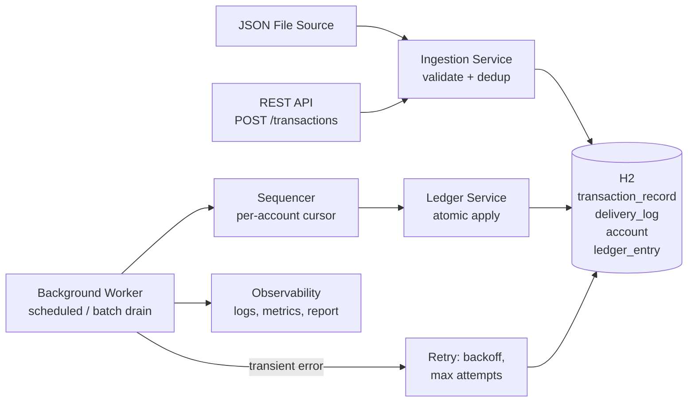
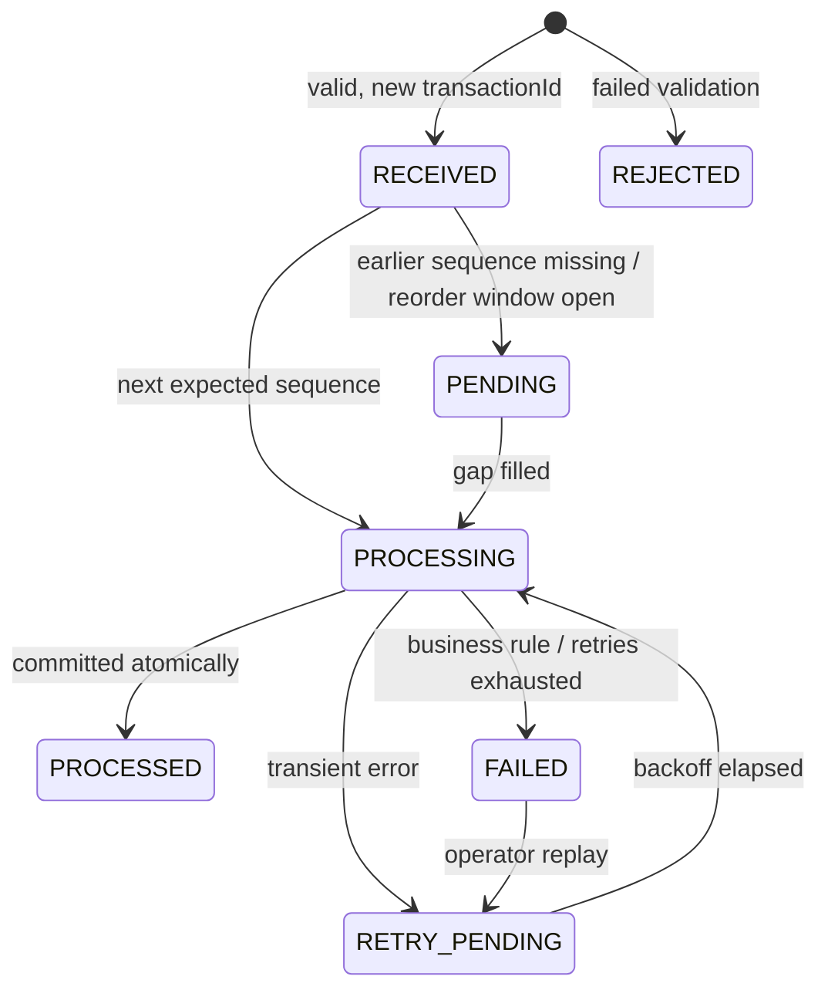

# High-Level Design — Idempotent Background Transaction Processing Service

**Assessment:** Practical FDE Assessment (FDE L2)
**Companion documents:** [README](../README.md) (quick start and summary) · [LLD](LLD.md) (classes, schema, algorithms, sequence diagrams)

---

## 1. Problem understanding

Upstream systems (APIs, files, schedulers, queues, retrying clients) deliver transaction requests **at least once** and **in any order**. Requests may be duplicated, replayed after partial failures, or arrive before the events they depend on.

The service must:

- apply each business transaction **exactly once in effect**, whatever the number of deliveries;
- apply transactions for an account in the **correct order**;
- survive transient failures and retry them **without double-applying** anything;
- never leave **partially updated** state;
- make every outcome (processed, duplicate, failed, retried, pending) **traceable and recoverable**.

The input mechanism is not the core challenge. The core challenge is safe processing under duplicate, out-of-order and retry conditions.

## 2. Scope

**In scope**

- Pluggable ingestion: JSON file (batch) and REST endpoint, behind a common source interface
- Input validation with bad-record isolation
- Background worker
- Idempotency store
- Per-account ordering
- Retry with a maximum attempt count
- Terminal failure handling and operator replay
- Processing summary report, structured logs, metrics
- Unit and scenario tests

**Out of scope**

- Real broker integration (an adapter seam only)
- Distributed transactions
- Multi-region deployment
- UI
- Authentication and authorisation
- A full observability stack

**Stack:** Java 17, Spring Boot 3.4, Spring Data JPA, H2 (embedded, file mode), JUnit 5, Micrometer.

## 3. Context and architecture

Intake and processing are **decoupled through the database**. The `transaction_record` table acts as a durable inbox (the "intake queue"):

- Intake is fast and idempotent, and never touches balances.
- The worker applies effects asynchronously.

This is the same shape as a queue consumer or a database-backed job processor, so a real broker can be added as one more ingestion adapter.

The design has four layers:

| Layer | Contents |
|---|---|
| **Ingestion** | Adapters (file, REST; later Kafka/SQS) and the idempotent intake service |
| **Processing** | Worker orchestration, sequencing, retry, atomic apply |
| **Domain** | Pure business rules: validation, payload fingerprint, status model. No framework dependencies. |
| **Infrastructure** | Persistence, logging, metrics, reporting |

## 4. Component responsibilities

| Component | Responsibility |
|---|---|
| **TransactionSource** | Abstracts the input. File and REST implementations; seam for a future broker adapter. |
| **TransactionValidator** | Checks mandatory fields, amount > 0 (max 4 decimal places), ISO-4217 currency, known type, sequence ≥ 1, and that a REVERSAL has an original transaction. Bad records are isolated and never stop the batch. |
| **IngestionService** | Looks up `transactionId` and compares payload fingerprints. Same → `DUPLICATE`, different → `CONFLICT`, new → stored as `RECEIVED`. Every delivery is audited. |
| **TransactionProcessor** | Per-account sequencing: applies only the next expected sequence, keeps later ones `PENDING`, reports gaps. Classifies failures and schedules retries. |
| **LedgerService** | Applies one transaction as a single atomic unit: ledger entry, balance, sequence cursor, status = `PROCESSED`. |
| **ReportService** | Counts by status and outcome, retries, gaps, failures, balances. |

## 5. Transaction model

| Field | Notes |
|---|---|
| `transactionId` | Business identifier; **idempotency key** |
| `requestId` | Delivery identifier; recorded for tracing and retry correlation |
| `accountId` | Account reference; ordering key (and the partition key in production) |
| `transactionType` | `CREDIT`, `DEBIT`, `REVERSAL` |
| `amount` | Decimal (`BigDecimal`), never floating point |
| `currency` | ISO-4217 code |
| `sequenceNumber` | Ordering within an account |
| `eventTime` | Optional; informational |
| `originalTransactionId` | Required for `REVERSAL` only |

**System-managed fields:** `status`, `attempts`, `payloadHash`, `lastError`, `nextAttemptAt`, `receivedAt`, `processedAt`.

## 6. Status lifecycle

The model keeps two separate things:

- **Transaction status:** one per `transactionId`.
- **Delivery outcome:** one per request received.

A duplicate is a property of a *delivery*, not of the transaction, so the original transaction keeps its own lifecycle.

**Delivery outcomes:** `ACCEPTED`, `DUPLICATE` (same id, same payload), `CONFLICT` (same id, different payload), `REJECTED`.

**Terminal transaction states:** `PROCESSED`, `FAILED`, `REJECTED`.

## 7. Key design decisions

### 7.1 Idempotency and duplicate detection

- The business key is **`transactionId`**. It is the primary key of `transaction_record`, so the database guarantees one row per transaction even under concurrent delivery.
- A SHA-256 fingerprint of the business fields separates a true duplicate from a conflicting reuse of the same id:
  - The fingerprint **excludes** `requestId` and `eventTime`, because retries legitimately carry new values for these.
  - Amounts are normalised, so `40` and `40.00` produce the same fingerprint.
- A conflicting payload is flagged and **never** applied. The original is kept.
- The only side effect is a ledger row. `UNIQUE(transaction_id)` and `UNIQUE(reversal_of)` on the ledger are the final backstop against double application.

### 7.2 Out-of-order handling — Option A, sequence-based, per account

- Each account keeps a cursor, `lastAppliedSeq`. Only `lastAppliedSeq + 1` may be applied.
- Higher sequences wait as `PENDING`.
- A *different* transaction claiming an already-used sequence → `FAILED` (`SEQUENCE_ALREADY_CONSUMED`).
- **Reorder window for new accounts.** A brand-new account has no cursor, so its records are buffered and the account then starts at the lowest sequence seen. The buffer lasts:
  - in batch mode, until the whole file is ingested;
  - in streaming mode, for a configurable window (5s).
  - **Why it's needed:** in the sample data, ACC-201's DEBIT (seq 2) arrives before its CREDIT (seq 1). Starting from whichever event arrives first would apply the debit before the credit.
- **Slots consumed without effect.**
  - A `FAILED` record uses up its sequence, so one bad transaction does not block the account forever.
  - A `REJECTED` record also uses up its sequence, unless a valid record claims the same sequence. Valid input always takes precedence.
- **Gaps.** A missing sequence leaves later records `PENDING`. They show up in the report with the exact missing numbers. In streaming mode, a gap older than `gap-alert-after` (5 minutes) raises an error log and a metric. Skipping a gap is an operator decision, because silently skipping could reorder money movements.

**Trade-off.** Ordering per account keeps accounts independent and parallel. It maps directly to partitioning by account key (Kafka partitions, SQS FIFO message groups) and it prevents false overdrafts. The cost is head-of-line blocking within one account while a sequence is missing or a retry is backing off. The alternatives were rejected:

- **Global sequence:** would serialise every account.
- **Option B (state-based):** a weaker fit, because balance correctness depends on order *across* transactions.
- **Option C (latest-state):** unsafe for a ledger, where no event may be "superseded".

### 7.3 Data consistency

- Applying one transaction is a single database transaction: ledger insert, balance update, cursor update and status = `PROCESSED`.
- The fault-injection hook fires **after** those writes and **before** commit. This deliberately tests the worst moment to fail, and shows the rollback leaves nothing behind.
- The account has optimistic locking (a version column) to protect against concurrent writers.

### 7.4 Resilience and retry

| Failure class | Examples | Handling |
|---|---|---|
| **Business (permanent)** | insufficient funds, currency mismatch, invalid reversal | `FAILED` immediately; no retry |
| **Transient** | downstream timeout (simulated), lock conflict, unexpected error | `RETRY_PENDING` with exponential backoff (200ms, 400ms, …); `FAILED` after 3 attempts |

- Later sequences for the same account wait while the head is retrying, so order is preserved.
- After retries are exhausted the record is `FAILED`, its sequence is used up, and the account continues.
- An operator can **replay** a `FAILED` transaction through `POST /admin/transactions/{id}/replay` once the cause is fixed.
- **Crash recovery.** A record left in `PROCESSING` (the process died mid-apply, so its transaction was rolled back) is reset to `RETRY_PENDING` at startup.

### 7.5 Observability

- **Logs:** one log event per state change in `key=value` form, with MDC context (`transactionId`, `requestId`, `attempt`). One configuration line switches to JSON output.
- **Metrics:** Micrometer counters `txn.deliveries{outcome}`, `txn.processing{result}` and `txn.sequence.gap.alerts`, exposed at `/actuator/metrics`.
- **Report:** `GET /report` and the batch summary show counts by status and outcome, retries, duplicates, conflicts, rejections, failures with reasons, sequence gaps and balances.

### 7.6 Security and data handling

- All input is validated before processing. Error messages never echo raw input values.
- `accountId` is masked in logs (`ACC***1`), and amounts are not logged.
- Configuration is externalised; there are no secrets in code (`DB_URL`, `DB_USER`, `DB_PASSWORD`).
- API errors return a stable code and, for unexpected errors, a reference id. They never include stack traces or internals.

## 8. Requirements traceability

### 8.1 Non-functional requirements

| NFR | How it is addressed |
|---|---|
| 6.1 Idempotency | `transactionId` primary key, payload fingerprint, ledger unique constraints (§7.1) |
| 6.2 Ordering | Per-account cursor, `PENDING` buffer, reorder window, gap report and alert (§7.2) |
| 6.3 Resilience | Classified failures, backoff, max attempts, replay, crash recovery (§7.4) |
| 6.4 Consistency | One atomic database transaction per applied event; optimistic locking (§7.3) |
| 6.5 Observability | Structured logs, metrics, processing report (§7.5) |
| 6.6 Security | Validation, masking, externalised configuration, safe errors (§7.6) |
| 6.7 Maintainability | Layered packages, framework-free domain, 46 automated tests |

### 8.2 Functional requirements

| FR | Where it is addressed |
|---|---|
| L2-FR-01 Replaceable input source | `TransactionSource`, file + REST adapters |
| L2-FR-02 Validation | `TransactionValidator`, `REJECTED` |
| L2-FR-03 / 04 Processing state and lifecycle | `transaction_record.status`, §6 |
| L2-FR-05 Process each transaction once | §7.1 |
| L2-FR-06 Detect late duplicates | §7.1 (duplicates are detected after `PROCESSED` too) |
| L2-FR-07 Out-of-order strategy | §7.2 |
| L2-FR-08 / 09 Simulated retryable failure; retry without duplicate effects | §7.3, §7.4 |
| L2-FR-10 Business logic separate from input handling | §3 layering |
| L2-FR-11 Processing summary | §7.5 |
| L2-FR-12 Tests | [LLD §9](LLD.md#9-test-matrix) |

## 9. Sample data walkthrough (brief §9.8)

| Arrival | Transaction | Outcome |
|---|---|---|
| 1 | TXN-2002 · ACC-201 · DEBIT 40 · seq 2 | Buffered until seq 1 is available, then `PROCESSED` |
| 2 | TXN-2001 · ACC-201 · CREDIT 100 · seq 1 | `PROCESSED` |
| 3 | TXN-2002 · REQ-2-DUP | Delivery `DUPLICATE` (same `transactionId`, same payload) |
| 4 | TXN-2003 · ACC-201 · CREDIT 25 · seq 3 | `PROCESSED` |
| 5 | TXN-2004 · ACC-202 · DEBIT −10 | `REJECTED`: amount must be greater than zero |
| 6 | TXN-2005 · ACC-203 · CREDIT 500 | Transient failure, `RETRY_PENDING`, then `PROCESSED` on attempt 2 |

**Final balances:**

- ACC-201 = **85** (100 − 40 + 25)
- ACC-203 = **500**
- ACC-202 = no account created

There are 4 ledger entries. Re-running the batch makes every delivery a `DUPLICATE` and changes nothing. See [samples/output.txt](../samples/output.txt).

## 10. Assumptions

| # | Assumption |
|---|---|
| A1 | Delivery is at-least-once. Duplicates and replays are expected conditions, not errors. |
| A2 | `transactionId` is globally unique and is the idempotency key. A request with a different `requestId` but the same `transactionId` is a duplicate. |
| A3 | The same `transactionId` with a different payload is a `CONFLICT`. It is flagged and not applied, and the original is kept. |
| A4 | `sequenceNumber` is per account and contiguous. A new account starts at the lowest sequence seen in its reorder window. |
| A5 | Invalid and failed records use up their sequence number, so one bad record never blocks an account. |
| A6 | Overdraft is not allowed. A DEBIT beyond the balance is `FAILED` and is not retried. |
| A7 | Each account has a single currency, set by its first applied transaction. No currency conversion. |
| A8 | A `REVERSAL` references `originalTransactionId` on the same account, reverses the full amount, and can be applied only once. |
| A9 | Embedded H2 (file mode) is acceptable persistence for the exercise. The design targets PostgreSQL in production. |
| A10 | Transient failures are simulated with a configurable fault injector (TXN-2005 fails once in the demo). |

## 11. Ambiguities in the brief and decisions taken

| # | Ambiguity | Decision | Rationale |
|---|---|---|---|
| D1 | Is `REQ-2-DUP` (new `requestId`, same `transactionId`) a duplicate? | Yes: dedup on `transactionId` | The brief's expected outcome says "Duplicate"; client retries often mint new request ids |
| D2 | Is `sequenceNumber` per account or global? | Per account | A global sequence serialises unrelated accounts; per-account ordering maps to partitioning |
| D3 | Same `transactionId`, different payload? | `CONFLICT`, never applied | Silently overwriting or applying would corrupt the ledger; it needs human attention |
| D4 | Does an invalid record block later sequences? | No: it uses up its slot | The brief requires invalid records not to stop the batch |
| D5 | Overdraft? | Not permitted | The safest default for money movement |
| D6 | `REVERSAL` semantics? | Full reversal of a `PROCESSED` original, once | The simplest semantics that is unambiguous to audit |
| D7 | What to do about a gap that never fills? | Report it plus an alert; skipping is an operator decision | Automatically skipping could reorder money movements |
| D8 | What happens to a transient failure after max retries? | `FAILED`, slot used up, replayable | Keeps the account flowing; nothing is lost |

## 12. Risks and mitigations

| Risk | Mitigation |
|---|---|
| Head-of-line blocking on a missing sequence | Gap report, alert after a threshold, operator action |
| A new account's events arrive spread out beyond the reorder window | Production: take the starting sequence from account onboarding instead of inferring it |
| Hot accounts limit how far per-account partitioning can scale out | Monitor partition lag; this is inherent to strict per-account ordering |
| Concurrent delivery of the same transaction | Primary-key and unique constraints; tested with 10 concurrent threads |
| Sensitive data in logs | Masked account ids; no amounts in logs |
