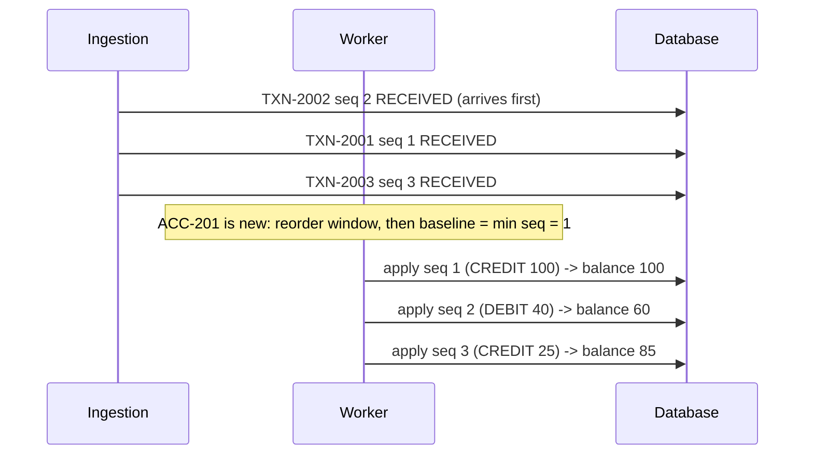
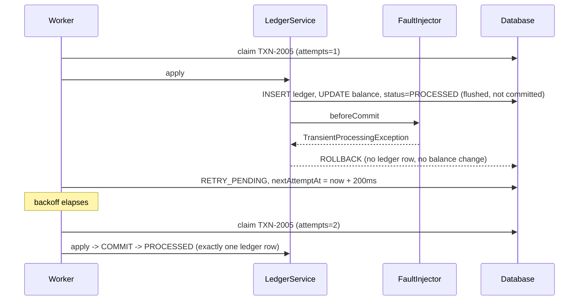
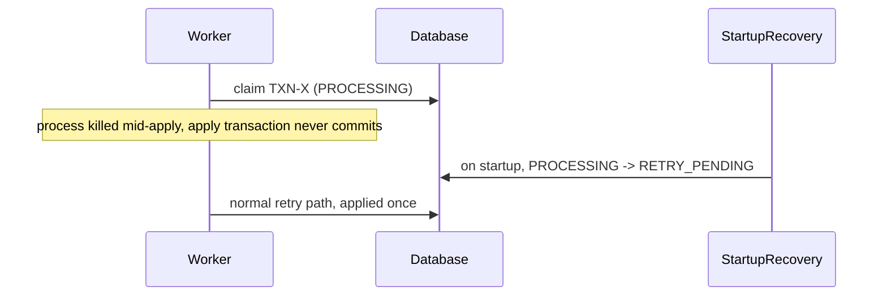

# Low-Level Design — Idempotent Background Transaction Processing Service

**Companion documents:** [README](../README.md) · [HLD](HLD.md)

---

## 1. Package structure

```
com.fde.txn
├── domain/        Pure Java. No Spring, no JPA.
│   ├── RawTransaction            untrusted input; every field is a nullable String
│   ├── TransactionValidator      RawTransaction -> ValidationResult (valid TransactionRequest or errors)
│   ├── TransactionRequest        validated, typed request (BigDecimal amount, enum type)
│   ├── PayloadHasher             SHA-256 business fingerprint (excludes requestId and eventTime)
│   ├── TransactionStatus         RECEIVED, PENDING, PROCESSING, RETRY_PENDING, PROCESSED, FAILED, REJECTED
│   ├── DeliveryOutcome           ACCEPTED, DUPLICATE, CONFLICT, REJECTED
│   └── BusinessRuleException / TransientProcessingException   failure classification
├── ingestion/     Input adapters and idempotent intake
│   ├── TransactionSource         port: List<RawTransaction> read()
│   ├── JsonFileTransactionSource batch-file adapter
│   ├── TransactionController     REST adapter, queries and admin replay
│   ├── RawTransactionMapper      tolerant JSON-to-RawTransaction mapping (one bad row cannot break a batch)
│   ├── IngestionService          validate, fingerprint, insert or classify, audit
│   └── ApiExceptionHandler       safe error responses
├── processing/    Background processing
│   ├── TransactionProcessor      sequencer, claim, apply, classify, retry, replay, recovery
│   ├── LedgerService             @Transactional atomic apply
│   ├── FaultInjector / ConfigurableFaultInjector   simulated transient failures
│   ├── ScheduledWorker           server mode: polls every 500ms
│   ├── StartupRecovery           re-queues records interrupted mid-apply
│   └── ProcessingProperties      typed configuration
├── persistence/   JPA entities and Spring Data repositories
├── reporting/     ReportService, ProcessingSummary, Views, ReportFormatter, TxnMetrics, LogMasker
└── app/           AppConfig (wires domain beans and the clock), BatchRunner (CLI mode)
```

**Dependency rule:** `ingestion` and `processing` depend on `domain` and `persistence`. `domain` depends on nothing. Business rules can therefore be unit-tested without Spring (see `TransactionValidatorTest` and `PayloadHasherTest`).

## 2. Data model

```sql
-- One row per business transaction. The PK *is* the idempotency key.
CREATE TABLE transaction_record (
  transaction_id          VARCHAR(64) PRIMARY KEY,
  request_id              VARCHAR(64),      -- first accepted delivery
  account_id              VARCHAR(64),
  transaction_type        VARCHAR(16),      -- CREDIT | DEBIT | REVERSAL (null if rejected)
  amount                  DECIMAL(19,4),
  currency                CHAR(3),
  sequence_number         BIGINT,
  original_transaction_id VARCHAR(64),
  event_time              TIMESTAMP,
  payload_hash            CHAR(64) NOT NULL,
  status                  VARCHAR(16) NOT NULL,
  attempts                INT NOT NULL,
  manual_replay           BOOLEAN,          -- operator replay allowed behind the cursor
  next_attempt_at         TIMESTAMP,
  last_error              VARCHAR(512),
  received_at             TIMESTAMP NOT NULL,
  processed_at            TIMESTAMP,
  version                 BIGINT            -- optimistic lock
);
CREATE INDEX ix_txn_status      ON transaction_record(status);
CREATE INDEX ix_txn_account_seq ON transaction_record(account_id, sequence_number);

-- Append-only audit of every delivery (answers "which requests were duplicates?")
CREATE TABLE delivery_log (
  id BIGINT IDENTITY PRIMARY KEY, request_id VARCHAR(64), transaction_id VARCHAR(64),
  outcome VARCHAR(16) NOT NULL, reason VARCHAR(512), received_at TIMESTAMP NOT NULL
);

-- Balance and ordering cursor
CREATE TABLE account (
  account_id VARCHAR(64) PRIMARY KEY, currency CHAR(3) NOT NULL,
  balance DECIMAL(19,4) NOT NULL, last_applied_seq BIGINT NOT NULL, version BIGINT
);

-- The only side effect. Unique constraints are the last line of defence.
CREATE TABLE ledger_entry (
  id BIGINT IDENTITY PRIMARY KEY,
  transaction_id VARCHAR(64) NOT NULL UNIQUE,
  account_id     VARCHAR(64) NOT NULL,
  amount         DECIMAL(19,4) NOT NULL,   -- signed
  balance_after  DECIMAL(19,4) NOT NULL,
  reversal_of    VARCHAR(64) UNIQUE,       -- a transaction can be reversed at most once
  created_at     TIMESTAMP NOT NULL
);
```

The schema is generated by Hibernate (`ddl-auto: update`). In production it would be managed with Flyway or Liquibase migrations.

## 3. Ingestion algorithm

```
ingest(raw):
  v = validator.validate(raw)
  if v.transactionId is null:                      # cannot identify: audit only
      log delivery REJECTED; return
  hash = v.valid ? hash(v.request) : hashRaw(raw)
  repeat up to 3 times:                            # handles concurrent insert races
    BEGIN
      existing = SELECT transaction_record WHERE transaction_id = v.transactionId
      if existing:
          outcome = (existing.hash == hash) ? DUPLICATE : CONFLICT
      else if v.valid:
          INSERT status=RECEIVED; outcome = ACCEPTED
      else:
          INSERT status=REJECTED (keeps accountId + seq so the slot is consumed); outcome = REJECTED
      INSERT delivery_log(outcome)
    COMMIT
    on PK violation / lock conflict: retry -> the row now exists -> classified as DUPLICATE or CONFLICT
```

## 4. Processing algorithm (one worker pass)

```
processOnce(windowClosed):
  eligible = records with status in (RECEIVED, PENDING, RETRY_PENDING), grouped by account
  for each account:
    sort records by (sequence, receivedAt, transactionId)
    consumed = seqs of FAILED records + seqs of REJECTED records not claimed by an eligible record
    if account exists: expected = lastAppliedSeq + 1
    else if !windowClosed and oldest.receivedAt + reorderWindow > now:
        mark RECEIVED -> PENDING; continue            # reorder window for a new account
    else: expected = min(eligible seqs, consumed)
    for rec in records:
      skip expected past consumed slots
      if rec.seq < expected:  manualReplay ? attempt(rec) : FAILED(SEQUENCE_ALREADY_CONSUMED)
      if rec.seq > expected:  mark rest PENDING; raise gap alert if stale; break
      if rec is backing off:  break                    # preserve order behind a retrying head
      result = attempt(rec)
      PROCESSED -> expected++ | FAILED -> consumed += seq | RETRY_SCHEDULED -> break

attempt(rec):
  TX1: status=PROCESSING, attempts++                   # claim (visible to crash recovery)
  TX2: LedgerService.apply(rec)                        # all-or-nothing
  on BusinessRuleException       -> TX3: FAILED (no retry)
  on DataIntegrityViolation      -> TX3: FAILED (duplicate effect prevented by constraint)
  on any other RuntimeException  -> attempts < max ? TX3: RETRY_PENDING(now + base * 2^(n-1))
                                                   : TX3: FAILED(RETRY_EXHAUSTED)

drain():                                               # batch mode
  loop processOnce(true) until no attempts were made and no retry is scheduled in the future
```

### LedgerService.apply (single transaction)

```
BEGIN
  rec = load; assert status == PROCESSING
  if ledger has rec.transactionId: mark PROCESSED; COMMIT     # defensive idempotency
  account = load or create(accountId, currency)
  assert account.currency == rec.currency                      # else CURRENCY_MISMATCH
  delta = CREDIT: +amount | DEBIT: -amount | REVERSAL: -(original ledger amount)
          (REVERSAL checks: original exists, is PROCESSED, same account, full amount, not already reversed)
  assert account.balance + delta >= 0                          # else INSUFFICIENT_FUNDS
  UPDATE account (balance, lastAppliedSeq = max(lastAppliedSeq, seq))
  INSERT ledger_entry
  UPDATE transaction_record SET status = PROCESSED
  FLUSH
  faultInjector.beforeCommit(id)                               # simulated failure AFTER all writes
COMMIT
```

## 5. Sequence diagrams

### 5.1 Happy path and duplicate delivery

```mermaid
sequenceDiagram
  participant C as Client / File
  participant I as IngestionService
  participant DB as Database
  participant W as Worker
  participant L as LedgerService
  C->>I: TXN-2001 (REQ-1)
  I->>DB: find TXN-2001 -> none; INSERT RECEIVED; log ACCEPTED
  I-->>C: 202 ACCEPTED
  C->>I: TXN-2001 (REQ-1-RETRY)
  I->>DB: find TXN-2001 -> same hash; log DUPLICATE
  I-->>C: 200 DUPLICATE
  W->>DB: claim TXN-2001 (PROCESSING, attempts=1)
  W->>L: apply(TXN-2001)
  L->>DB: ledger + balance + cursor + PROCESSED (one commit)
```

### 5.2 Out-of-order delivery (brief data, ACC-201)



In streaming mode with an existing account, a missing sequence makes the later record `PENDING`. It is released on the first pass after the gap is filled (`OutOfOrderTest.laterSequenceWaitsAsPendingUntilTheGapIsFilled`).

### 5.3 Transient failure after the side effect, then retry



### 5.4 Crash recovery



## 6. Concurrency model

| Concern | Current implementation | Production evolution |
|---|---|---|
| Duplicate intake under concurrency | Primary key on `transaction_id`; insert race retried and classified | Same (PostgreSQL `INSERT … ON CONFLICT DO NOTHING`) |
| Concurrent workers | One worker at a time (in-process lock) | One consumer per account partition (Kafka key = accountId) or `SELECT … FOR UPDATE SKIP LOCKED` per account |
| Lost updates on balance | `@Version` optimistic lock on `account` | Same, or row lock inside the apply transaction |
| Double effect | `UNIQUE(ledger.transaction_id)`, `UNIQUE(ledger.reversal_of)` | Same, plus a transactional outbox for downstream events |

## 7. API contract

| Method | Path | Response |
|---|---|---|
| `POST` | `/transactions` | Single object: `202 ACCEPTED`, `200 DUPLICATE`, `409 CONFLICT`, `400 REJECTED`. Array: `207` with a result per item. |
| `GET` | `/transactions/{id}` | Transaction state plus all deliveries; `404` if unknown |
| `GET` | `/transactions` | All transactions (demo convenience; paginate in production) |
| `GET` | `/accounts/{id}` | Balance, cursor and ledger lines |
| `GET` | `/report` | `ProcessingSummary` (counts, duplicates, conflicts, rejected, failed, gaps, balances) |
| `POST` | `/admin/transactions/{id}/replay` | `202` re-queued; `409` if the transaction is not `FAILED` |
| `GET` | `/actuator/health`, `/actuator/metrics/txn.deliveries`, `/actuator/metrics/txn.processing` | Operations |

**Example request:**

```json
{ "transactionId": "TXN-2001", "requestId": "REQ-1", "accountId": "ACC-201",
  "transactionType": "CREDIT", "amount": 100, "currency": "USD", "sequenceNumber": 1 }
```

**Example response:**

```json
{ "requestId": "REQ-1", "transactionId": "TXN-2001", "outcome": "ACCEPTED",
  "transactionStatus": "RECEIVED", "reason": null }
```

The mapper also accepts these field-name aliases: `type`, `sequence`, `idempotencyKey`.

## 8. Configuration

| Property | Default | Purpose |
|---|---|---|
| `processing.max-attempts` | `3` | Total attempts before `FAILED` |
| `processing.base-backoff` | `200ms` | First retry delay; doubles each attempt |
| `processing.reorder-window` | `5s` | Buffer for a new account's events (server mode) |
| `processing.gap-alert-after` | `5m` | Alert threshold for a missing sequence |
| `processing.worker.enabled` / `interval-ms` | `true` / `500` | Scheduled worker (off in batch mode) |
| `processing.fault.transient-failures` | `{TXN-2005: 1}` | Simulated transient failures |
| `DB_URL`, `DB_USER`, `DB_PASSWORD` | H2 file `./data/txndb` | Externalised connection settings |
| `logging.structured.format.console` | (off) | Set to `logstash` for JSON logs |

## 9. Test matrix

46 automated tests (`./mvnw test`). Integration tests run against an isolated in-memory H2 database, with the scheduler disabled and zero backoff.

| Scenario | Test | Requirement |
|---|---|---|
| Brief §9.8 dataset end to end (statuses, attempts, balances, ledger count) | `SampleDatasetScenarioTest` | FR-04/05/06/07/08/09, AC 9.7 |
| New `requestId` + same `transactionId` → `DUPLICATE` | `IdempotencyTest` | FR-05, FR-06 |
| Same id with a different payload → `CONFLICT`, never applied | `IdempotencyTest` | 6.1 |
| Late duplicate after `PROCESSED`; full batch replay changes nothing | `IdempotencyTest` | FR-06 |
| 10 concurrent deliveries → 1 record, 1 ledger entry | `IdempotencyTest` | 6.1, 6.4 |
| 25 seeded shuffles of an order-sensitive dataset → identical final state | `OutOfOrderTest` | FR-07 |
| Gap → `PENDING` + reported missing seq → released when filled | `OutOfOrderTest` | FR-07 |
| Reorder window for a new account (streaming) | `OutOfOrderTest` | FR-07 |
| Rejected record uses up its slot; a valid record takes precedence | `OutOfOrderTest` | FR-02, AC "invalid isolated" |
| Reused sequence → `FAILED` | `OutOfOrderTest` | FR-07 |
| Fault after side effect → rollback → retry → exactly one effect | `RetryAndFailureTest` | FR-08/09, 6.4 |
| Retry exhaustion → `FAILED` (attempts = 3), account continues | `RetryAndFailureTest` | 6.3 |
| Head-of-line wait while retrying (no overdraft) | `RetryAndFailureTest` | FR-07, 6.3 |
| Overdraft / currency mismatch → permanent `FAILED`, not retried | `RetryAndFailureTest` | 6.3 |
| Operator replay; crash recovery from `PROCESSING` | `RetryAndFailureTest` | 6.3 "recoverable" |
| Reversal once; partial reversal / unknown original rejected | `ReversalTest` | domain rules |
| REST status codes, batch isolation, safe malformed-JSON error, queries | `TransactionControllerTest` | FR-01, 6.6 |
| Every validation rule; errors never echo input | `TransactionValidatorTest` | FR-02, 6.6 |
| Fingerprint ignores `requestId`, `eventTime` and amount scale | `PayloadHasherTest` | 6.1 |

## 10. Error-handling summary

| Situation | Status / outcome | Retried? | Visible in |
|---|---|---|---|
| Malformed or invalid field | `REJECTED` | No | delivery log, report "Rejected" |
| Missing `transactionId` | delivery `REJECTED`, no record | No | delivery log |
| Duplicate delivery | delivery `DUPLICATE` | n/a | report "Duplicate" |
| Same id, different payload | delivery `CONFLICT` | n/a | report "Conflict", WARN log |
| Business rule violation | `FAILED` (code in `lastError`) | No | report "Failed" |
| Transient error | `RETRY_PENDING`, then `FAILED` after max attempts | Yes, with backoff | WARN log, metric |
| Missing sequence | `PENDING` | Released when the gap fills | report "Sequence gap", alert |
| Process crash mid-apply | `PROCESSING`, then `RETRY_PENDING` at startup | Yes | WARN log |
